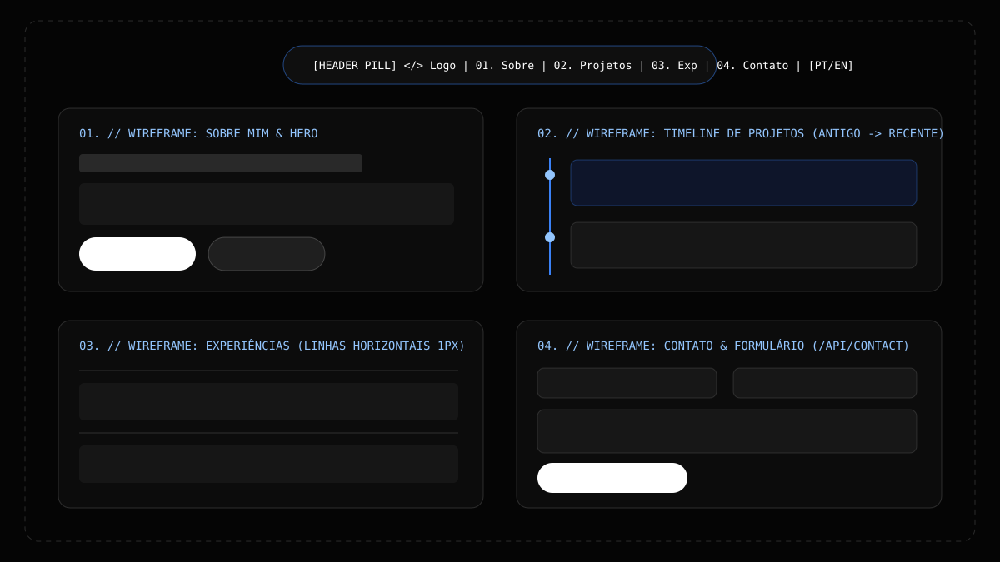
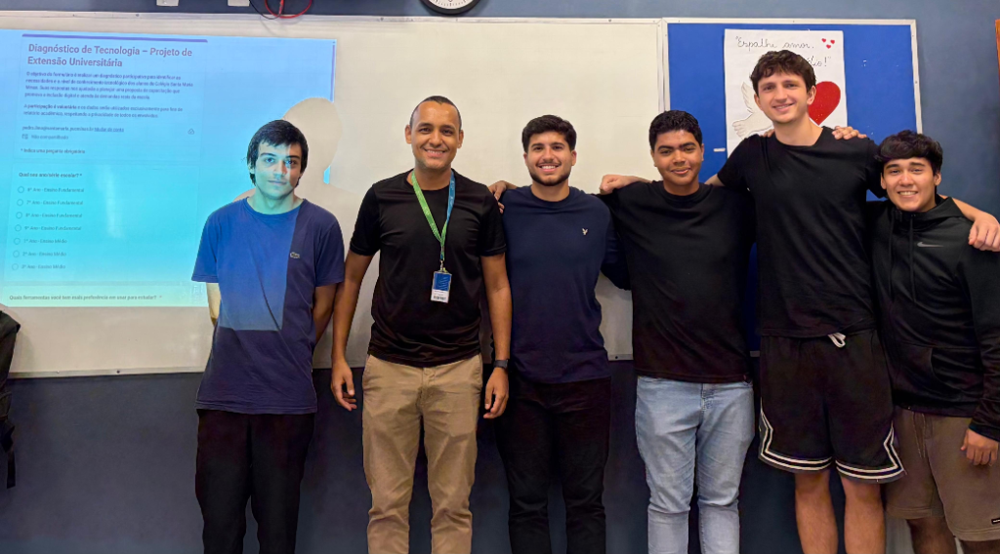

---

# 👨‍💻 Portfólio Profissional - Davi Rocha

> [!NOTE]
> Plataforma web de **Portfólio Profissional e Acadêmico** desenvolvida para centralizar e apresentar minha trajetória no curso de **Ciência da Computação na PUC Minas (Campus Coração Eucarístico)**, minhas experiências em Segurança da Informação e produção audiovisual, meus projetos práticos e certificações internacionais.

<table>
  <tr>
    <td width="800px">
      <div align="justify">
        Este <b>Portfólio Profissional</b> foi desenvolvido como projeto prático da disciplina de <b>Desenvolvimento de Interfaces Web (DIW)</b> do curso de Bacharelado em <b>Ciência da Computação</b> da <b>Pontifícia Universidade Católica de Minas Gerais (PUC Minas — Campus Coração Eucarístico)</b>, sob orientação do <a href="https://github.com/joaopauloaramuni">Prof. Dr. João Paulo Aramuni</a>. A aplicação foi construída com arquitetura moderna utilizando <b>Next.js 14 (App Router)</b>, <b>TypeScript</b>, <b>Tailwind CSS</b> e componentes no padrão <b>shadcn/ui</b>, reunindo em uma interface minimalista em <i>Dark Mode</i> (com gradientes difusos e textura granulada via filtro SVG) minha apresentação pessoal, linha do tempo interativa de projetos, experiências profissionais na <b>Trinité</b>, conquistas acadêmicas, suporte instantâneo a múltiplos idiomas (<b>PT | EN</b>) e formulário de contato funcional integrado a uma rota de API Serverless (<code>/api/contact</code>) e ao <b>EmailJS</b>.
      </div>
    </td>
    <td>
      <div>
        
      </div>
    </td>
  </tr> 
</table>

---

## 🚧 Status do Projeto

### Badges Principais:

[](https://github.com/davicampolina)
[](https://github.com/davicampolina)
[](https://github.com/joaopauloaramuni/desenvolvimento-de-interfaces-web)
[](#licença)

### Stack & Tecnologias do Repositório:

[](https://github.com/davicampolina)


---

## 📚 Índice
- [Links Úteis](#-links-úteis)
- [Sobre o Projeto](#-sobre-o-projeto)
  - [Projetos Relacionados (Presentes no Portfólio)](#-projetos-relacionados-presentes-no-portfólio)
- [Funcionalidades Principais](#-funcionalidades-principais)
- [Tecnologias Utilizadas](#-tecnologias-utilizadas)
- [Arquitetura](#-arquitetura)
  - [Wireframes e Protótipos (Figma)](#wireframes-e-protótipos-figma)
- [Instalação e Execução](#-instalação-e-execução)
  - [Pré-requisitos](#pré-requisitos)
  - [Variáveis de Ambiente](#-variáveis-de-ambiente)
     - [1 Back-end & Front-end (Next.js .env.local)](#1-back-end--front-end-nextjs-envlocal)
     - [2 Configuração de Variáveis de Ambiente na Vercel](#2-configuração-de-variáveis-de-ambiente-na-vercel)
  - [Instalação de Dependências](#-instalação-de-dependências)
  - [Como Executar a Aplicação](#-como-executar-a-aplicação)
- [Deploy](#-deploy)
- [Estrutura de Pastas](#-estrutura-de-pastas)
- [Demonstração](#-demonstração)
  - [Aplicativo Mobile (Responsividade)](#-aplicativo-mobile-responsividade)
  - [Aplicação Web (Desktop)](#-aplicação-web-desktop)
  - [Exemplo de Saída no Terminal (API de Contato)](#-exemplo-de-saída-no-terminal-api-de-contato)
- [Testes](#-testes)
- [Documentações utilizadas](#-documentações-utilizadas)
- [Autores](#-autores)
- [Contribuição](#-contribuição)
- [Agradecimentos](#-agradecimentos)
- [Licença](#-licença)

---

## 🔗 Links Úteis
* 🌐 **Demo Online (Vercel):** [Acesse a Aplicação Web na Vercel]([INSERIR LINK AQUI])
  > 💻 **Descrição:** Link de acesso para o Portfólio Profissional publicado em produção na nuvem (Vercel).
* 🎨 **Protótipo e Wireframes (Figma):** [Acesse o Projeto no Figma]([INSERIR LINK AQUI])
  > 📐 **Descrição:** Link para visualização dos wireframes e protótipo de interface desenvolvidos para a disciplina de DIW.
* 📖 **Repositório no GitHub:** [github.com/davicampolina](https://github.com/davicampolina)
  > 📚 **Descrição:** Acesso ao perfil e código-fonte completo do projeto no GitHub.

---

## 📝 Sobre o Projeto

O **Portfólio Profissional** foi concebido na disciplina de **Desenvolvimento de Interfaces Web (DIW)** da **PUC Minas (Campus Coração Eucarístico)** com o objetivo de consolidar e apresentar, em uma plataforma web autoral e responsiva, minha evolução acadêmica na **Ciência da Computação** e minha trajetória profissional.

- **Por que ele existe:** Nasceu da necessidade acadêmica e profissional de reunir, em um único ambiente digital de alta qualidade visual, meus projetos universitários e de mercado, minha atuação como Estagiário em Segurança da Informação na **Trinité**, minha experiência consolidada com design, direção, edição e fotografia, além de minhas premiações em olimpíadas científicas.
- **Qual problema ele resolve:** Substitui currículos estáticos por uma experiência interativa, bilíngue (`PT` e `EN`), acessível em qualquer dispositivo e integrada a um canal direto de comunicação via API de e-mail.
- **Qual o contexto:** Projeto acadêmico desenvolvido no curso de Ciência da Computação da PUC Minas (Coração Eucarístico) com aplicação direta no mercado de tecnologia e segurança da informação.
- **Onde ele pode ser utilizado:** Apresentação profissional para recrutadores, professores, parceiros de projetos acadêmicos, clientes e comunidade técnica.

### 🚀 Projetos Relacionados (Presentes no Portfólio)

Dentro da seção **`02. // Projetos`**, o portfólio destaca em ordem cronológica os seguintes projetos desenvolvidos ao longo da minha trajetória:

1. **Educação em IA & Machine Learning no Ensino Fundamental (Projeto de Extensão — 1º Período):** Projeto de extensão universitária voltado exclusivamente ao ensino de Inteligência Artificial, Machine Learning e uso ético, consciente e responsável da IA para alunos do ensino fundamental.
2. **FlowBack — Recirculação Inteligente de Água:** Protótipo inteligente desenvolvido com **Arduino**, programação em **C++** e simulação no **Tinkercad** que redireciona a água fria desperdiçada em chuveiros elétricos (enquanto aquecem) para atividades produtivas, como regar o jardim, liberando o fluxo para o banho assim que atinge a temperatura ideal.
3. **Sidney Rocha Advocacia ([sidneyrocha.com.br](https://sidneyrocha.com.br)):** Criação e design visual do site institucional do escritório, apresentando serviços especializados em Direito Digital e adequação à LGPD com uso de **WordPress**, **HTML**, **CSS** e **JavaScript**.
4. **CyberSense — Plataforma Educacional contra Engenharia Social (Projeto em Desenvolvimento — TI 2):** Plataforma SaaS educacional focada na proteção digital contra engenharia social, atendendo desde a terceira idade até profissionais de tecnologia por meio de simulações personalizadas de ataques (*Spear Phishing*), ferramentas de conscientização, páginas didáticas de interceptação, painéis analíticos em tempo real e travas rígidas de privacidade.

---

## ✨ Funcionalidades Principais

- 🌐 **Internacionalização Instantânea (i18n — `PT` | `EN`):** Contexto global (`LanguageContext`) que alterna em tempo real todo o conteúdo textual do site (menus, apresentação, sobre mim, projetos, experiências, certificados, formulário e rodapé) entre Português e Inglês, persistindo a preferência no `localStorage`.
- 🎨 **Identidade Visual Dark Mode com Gradiente Difuso + High-Grain Noise:** Fundo em preto profundo (`#030303`) com manchas orgânicas em azul-cobalto (`#1D4ED8`), azul-elétrico (`#3B82F6`) e azul-gelo (`#93C5FD`), sobrepostas por um filtro SVG global `<feTurbulence type="fractalNoise" baseFrequency="0.8" />` e acabamento de vidro fosco (`backdrop-blur-xl`).
- 🧭 **Menu Flutuante em Pílula com Rolagem Suave:** Cabeçalho fixo (`Header`) com detecção automática da seção ativa durante o scroll, indicador luminoso animado via Framer Motion e menu responsivo para dispositivos móveis.
- ⏳ **Linha do Tempo (Timeline) Dinâmica de Projetos:** Exibição cronológica (do projeto mais antigo ao mais recente) com animações de entrada, galerias de fotos reais dos projetos, tags monoespaçadas e finalização suave em gradiente.
- 🏆 **Seção de Certificados, Olimpíadas & Conquistas:** Exibição estruturada das medalhas na *Olimpíada Internacional Matemática Sem Fronteiras (2024 e 2025)*, *Concurso Canguru de Matemática (2022 e 2024)*, certificação *Cambridge English* e 1º lugar na competição audiovisual *"Construtores da Paz"* (com link direto para o vídeo premiado).
- 📨 **Formulário de Contato com Validação e Rota de API (`/api/contact`):** Validação de campos obrigatórios e formato de e-mail via **React Hook Form**, conectada ao Route Handler back-end do Next.js e ao **EmailJS** (com *fallback* automático simulado para testes locais).

---

## 🛠 Tecnologias Utilizadas

As seguintes ferramentas, frameworks e bibliotecas instaladas no [`package.json`](./package.json) foram utilizadas na construção deste projeto:

### 💻 Front-end & UI

* **Framework Principal:** Next.js `14.2.18` (App Router)
* **Biblioteca de Interface:** React `^18.3.1` & React DOM `^18.3.1`
* **Linguagem/Superset:** TypeScript `^5.6.3`
* **Estilização:** Tailwind CSS `^3.4.15`, PostCSS `^8.4.49` & Autoprefixer `^10.4.20`
* **Componentes UI (Padrão shadcn/ui):** `clsx` (`^2.1.1`) + `tailwind-merge` (`^2.5.4`)
* **Animações e Transições:** Framer Motion `^11.11.17`
* **Ícones Vetoriais:** Lucide React `^0.460.0`
* **Gerenciamento de Estado & i18n:** React Context API (`LanguageContext.tsx`)
* **Formulários e Validação:** React Hook Form `^7.53.2`

### 🖥️ Back-end & Integração de E-mail

* **Runtime / Ambiente:** Node.js (v18+ / v20+)
* **API Serverless:** Next.js Route Handlers (`src/app/api/contact/route.ts`)
* **Serviço de Disparo de E-mails:** EmailJS (`@emailjs/browser` `^4.4.1` + EmailJS REST API)

### ⚙️ Infraestrutura, Padronização & Hospedagem

* **Padronização de Código:** ESLint `^8.57.1` & `eslint-config-next` `14.2.18`
* **Cloud & Deploy Contínuo (CI/CD):** Vercel Cloud Platform
* **Controle de Versão:** Git & GitHub

---

## 🏗 Arquitetura

O projeto adota uma **Arquitetura Fullstack Monolítica Modular Serverless** baseada no **Next.js 14 App Router**:

- **Camada de Apresentação (`src/components/`):** Dividida em componentes de seção independentes (`HeroSection`, `AboutSection`, `ProjectsTimeline`, `ExperienceSection`, `CertificatesSection`, `ContactSection`, `Header`, `Footer`, `BackgroundAtmosphere`) e primitivos visuais reutilizáveis no padrão **shadcn/ui** (`src/components/ui/`).
- **Camada de Dados Centralizada (`src/data/portfolioData.ts`):** Concentra todas as informações textuais em Português e Inglês, projetos, experiências e certificados em estruturas fortemente tipadas com TypeScript, desacoplando o conteúdo da lógica visual.
- **Camada de Estado Global (`src/context/LanguageContext.tsx`):** Provedor React que distribui o idioma selecionado (`pt-BR` ou `en`) e a função tradutora `t()` para todos os componentes da árvore sem *prop drilling*.
- **Camada de API Back-end (`src/app/api/contact/route.ts`):** Endpoint HTTP `POST` que valida os campos recebidos (`name`, `email`, `message`), comunica-se com a API do EmailJS utilizando variáveis de ambiente e retorna respostas padronizadas em JSON.

### Wireframes e Protótipos (Figma)

Para visualização do planejamento visual e estrutural das seções do portfólio:

> ⚠️ **[INSERIR LINK AQUI]:** Substitua ou adicione abaixo as imagens finais exportadas dos seus wireframes do Figma.

| Wireframe Geral (Arquitetura das Seções) | Protótipo de Alta Fidelidade (Figma) |
| :---: | :---: |
|  | **[INSERIR LINK AQUI — Imagem do Figma Desktop/Mobile]** |

---

## 🔧 Instalação e Execução

### Pré-requisitos
Certifique-se de ter instalado em sua máquina:

* **Node.js:** Versão LTS (`v18.17+` ou `v20+`)
* **Gerenciador de Pacotes:** `npm` (instalado junto com o Node.js)
* **Git:** Para clonagem e versionamento do repositório

---

### 🔑 Variáveis de Ambiente

O projeto utiliza variáveis de ambiente para integração do formulário de contato com o **EmailJS**. Um arquivo modelo documentado já está disponível na raiz como [`.env.example`](./.env.example).

#### 1 Back-end & Front-end (Next.js `.env.local`)

Copie o arquivo `.env.example` para `.env.local` na raiz do projeto e preencha com suas credenciais do [EmailJS](https://www.emailjs.com/):

| Variável | Descrição | Exemplo |
| :--- | :--- | :--- |
| `NEXT_PUBLIC_EMAILJS_SERVICE_ID` | ID do serviço de e-mail configurado no painel do EmailJS. | `service_xxxxxxx` |
| `NEXT_PUBLIC_EMAILJS_TEMPLATE_ID` | ID do template de mensagem no EmailJS. | `template_xxxxxxx` |
| `NEXT_PUBLIC_EMAILJS_PUBLIC_KEY` | Chave pública da conta EmailJS. | `user_xxxxxxxxxxxxx` |
| `EMAILJS_PRIVATE_KEY` | Chave privada opcional para disparo via Route Handler no servidor. | `prv_xxxxxxxxxxxxx` |

> [!TIP]
> **Modo de Fallback Automático:** Caso as variáveis acima ainda não estejam configuradas, a rota `/api/contact` opera automaticamente em modo de simulação seguro, validando todos os campos e retornando sucesso (`HTTP 200`) para permitir testes locais completos.

#### 2 Configuração de Variáveis de Ambiente na Vercel

Ao publicar o projeto na **Vercel**, acesse **Project Settings > Environment Variables** e adicione as mesmas chaves:

```env
NEXT_PUBLIC_EMAILJS_SERVICE_ID=seu_service_id_aqui
NEXT_PUBLIC_EMAILJS_TEMPLATE_ID=seu_template_id_aqui
NEXT_PUBLIC_EMAILJS_PUBLIC_KEY=sua_public_key_aqui
EMAILJS_PRIVATE_KEY=sua_private_key_opcional
```

---

### 📦 Instalação de Dependências

1. **Clone o Repositório:**

```bash
git clone https://github.com/davicampolina/portfolio-profissional.git
cd portfolio-profissional
```

2. **Instale as Dependências do Node.js:**

```bash
npm install
```

---

### ⚡ Como Executar a Aplicação

1. **Inicie o Servidor de Desenvolvimento do Next.js:**

```bash
npm run dev
```

🎨 *A aplicação completa (Front-end + Rota de API `/api/contact`) estará disponível em **http://localhost:3000**.*

2. **Comandos Adicionais de Build e Produção Local:**

```bash
# Gera a versão otimizada de produção e valida a tipagem TypeScript
npm run build

# Inicia o servidor Next.js em modo de produção após o build
npm run start

# Executa a verificação de código com ESLint
npm run lint
```

---

## 🚀 Deploy

O projeto está configurado para deploy imediato na plataforma **Vercel**:

1. Suba o código para um repositório no seu **GitHub** (`git push origin main`).
2. Acesse [https://vercel.com/new](https://vercel.com/new) e importe o repositório do projeto.
3. A Vercel detectará automaticamente o framework **Next.js**.
4. Adicione as variáveis de ambiente do arquivo `.env.example` na aba **Environment Variables** (opcional).
5. Clique em **Deploy**.

* 🌐 **Link Final na Vercel:** **[INSERIR LINK AQUI]**

---

## 📂 Estrutura de Pastas

Abaixo está a árvore de diretórios real e exata construída neste projeto:

```text
portfolio-profissional/
├── .env.example                        # 🧩 Modelo documentado das variáveis de ambiente (EmailJS)
├── .gitignore                          # 🧹 Arquivos e pastas ignorados pelo Git (node_modules, .next, .env)
├── next.config.mjs                     # ⚙️ Configurações do framework Next.js
├── package.json                        # 📦 Dependências instaladas e scripts (dev, build, start, lint)
├── package-lock.json                   # 🔒 Lockfile das versões exatas dos pacotes
├── postcss.config.mjs                  # 🎨 Configuração do PostCSS para o Tailwind CSS
├── tailwind.config.ts                  # 🎨 Paleta de cores Dark Mode, fontes e extensões do Tailwind
├── tsconfig.json                       # 🛠️ Configuração estrita do compilador TypeScript e path aliases (@/*)
├── README.md                           # 📘 Documentação acadêmica e técnica completa do projeto
│
├── public/                             # 📂 Arquivos estáticos públicos
│   ├── profile-avatar.jpg              # 🖼️ Foto de perfil circular exibida na seção inicial (Hero)
│   ├── profile.jpg                     # 🖼️ Imagem de perfil original
│   ├── projects/                       # 📂 Imagens reais dos projetos exibidos na Timeline
│   │   ├── extensao-ia-1.png           # 🖼️ Foto da equipe no Projeto de Extensão em IA (1º Período)
│   │   ├── extensao-ia-2.jpg           # 🖼️ Foto da apresentação em sala sobre IA e Machine Learning
│   │   └── sidney-rocha-site.png       # 🖼️ Captura de tela do site institucional Sidney Rocha Advocacia
│   └── wireframes/                     # 📂 Wireframes e diagramas de interface
│       └── figma-wireframe.svg         # 📐 Wireframe estrutural das seções do portfólio
│
└── src/                                # 📂 Código-fonte principal da aplicação
    ├── app/                            # 📂 Rotas do Next.js 14 (App Router)
    │   ├── api/
    │   │   └── contact/
    │   │       └── route.ts            # 🔌 Rota de API Back-end (POST /api/contact) + integração EmailJS
    │   ├── globals.css                 # 🎨 Estilos globais Dark Mode (#030303) e barra de rolagem customizada
    │   ├── layout.tsx                  # 📄 Layout raiz com fontes (Inter e JetBrains Mono) e LanguageProvider
    │   └── page.tsx                    # 📄 Página principal integrando Header, Main (Seções 01 a 05) e Footer
    │
    ├── components/                     # 🧱 Componentes modulares da interface
    │   ├── ui/                         # 🧱 Componentes base reutilizáveis no padrão shadcn/ui
    │   │   ├── badge.tsx               # 🏷️ Badges monoespaçadas para tecnologias e metadados
    │   │   ├── button.tsx              # 🔘 Botões em formato de pílula (Primary Clean, Matte, Outline, Ghost)
    │   │   ├── card.tsx                # 🪪 Containers com acabamento de vidro fosco (Frosted Glass)
    │   │   ├── input.tsx               # ⌨️ Campos de entrada de texto estilizados
    │   │   └── textarea.tsx            # 📝 Área de texto para mensagem no formulário de contato
    │   ├── AboutSection.tsx            # 📄 Seção 01. // Sobre Mim (Biografia, Linguagens e Experiência Criativa)
    │   ├── BackgroundAtmosphere.tsx    # 🌌 Gradientes difusos azuis + Filtro SVG feTurbulence High-Grain Noise
    │   ├── CertificatesSection.tsx     # 🏆 Seção 04. // Certificados & Premiações (Olimpíadas, Audiovisual e Inglês)
    │   ├── ContactSection.tsx          # 📨 Seção 05. // Contato (Links diretos + Formulário React Hook Form)
    │   ├── ExperienceSection.tsx       # 💼 Seção 03. // Experiências (Estágio na Trinité, Audiovisual e Formação)
    │   ├── Footer.tsx                  # 🦶 Rodapé minimalista com navegação rápida e links sociais
    │   ├── Header.tsx                  # 🧭 Menu superior flutuante em pílula + Seletor de idioma (PT | EN)
    │   ├── HeroSection.tsx             # 🚀 Apresentação inicial com foto de perfil circular e CTAs
    │   └── ProjectsTimeline.tsx        # ⏳ Seção 02. // Projetos (Timeline interativa com finalização suave)
    │
    ├── context/                        # 🌐 Gerenciamento de estado global
    │   └── LanguageContext.tsx         # 🌍 Contexto de Internacionalização instantânea (PT-BR | EN)
    │
    ├── data/                           # 🗄️ Camada de dados estruturados
    │   └── portfolioData.ts            # 📚 Textos bilíngues (PT/EN), projetos, experiências e certificados
    │
    └── lib/                            # 🛠️ Funções utilitárias
        └── utils.ts                    # 🔧 Utilitário cn() para fusão de classes Tailwind (clsx + tailwind-merge)
```

---

## 🎥 Demonstração

> ⚠️ **[INSERIR LINK AQUI]:** Insira abaixo os GIFs ou capturas de tela da aplicação rodando no navegador e no celular após o deploy.

### 📱 Aplicativo Mobile (Responsividade)

| Versão Mobile — Apresentação & Sobre Mim | Versão Mobile — Timeline de Projetos & Contato |
| :---: | :---: |
| **[INSERIR LINK AQUI — Print Mobile 1]** | **[INSERIR LINK AQUI — Print Mobile 2]** |

### 🌐 Aplicação Web (Desktop)

| Seção | Captura de Tela / Preview |
| :---: | :---: |
| **Apresentação Inicial (Hero) & Foto de Perfil** |  |
| **Projeto 01 — Extensão Universitária em IA** |  |
| **Projeto 03 — Site Sidney Rocha Advocacia** |  |
| **Visão Completa da Página Web** | **[INSERIR LINK AQUI — Captura de Tela da Home Completa]** |

### 💻 Exemplo de Saída no Terminal (API de Contato)

Demonstração de uma requisição `POST` para o Route Handler back-end (`/api/contact`):

```bash
curl -X POST 'http://localhost:3000/api/contact' \
     -H 'Content-Type: application/json' \
     -d '{
       "name": "Avaliador DIW",
       "email": "avaliador@pucminas.br",
       "message": "Olá Davi, testando o envio de mensagens pela rota de API do seu portfólio!"
     }'
```

**Saída Esperada (`HTTP 200 OK`):**
```json
{
  "ok": true,
  "provider": "simulated-api-fallback",
  "timestamp": "2026-10-16T17:30:00.000Z",
  "data": {
    "name": "Avaliador DIW",
    "email": "avaliador@pucminas.br",
    "preview": "Olá Davi, testando o envio de mensagens pela rota de API do seu portfólio!"
  },
  "message": "Mensagem recebida e validada com sucesso pela rota /api/contact."
}
```

---

## 🧪 Testes

### Validação de Tipagem Estática, Linting e Build de Produção
Para verificar a integridade dos tipos TypeScript, regras do ESLint e compilação das rotas estáticas e dinâmicas do Next.js:

```bash
npm run lint
npm run build
```

---

## 🔗 Documentações utilizadas

* 📖 **Framework Fullstack:** [Documentação Oficial do **Next.js (App Router)**](https://nextjs.org/docs)
* 📖 **Biblioteca UI:** [Documentação Oficial do **React**](https://react.dev/reference/react)
* 📖 **Estilização:** [Documentação do **Tailwind CSS**](https://tailwindcss.com/docs)
* 📖 **Componentes UI:** [Guia de Arquitetura do **shadcn/ui**](https://ui.shadcn.com/docs)
* 📖 **Animações:** [Documentação do **Framer Motion**](https://www.framer.com/motion/)
* 📖 **Formulários:** [Documentação do **React Hook Form**](https://react-hook-form.com/get-started)
* 📖 **Envio de E-mails:** [Documentação do **EmailJS SDK**](https://www.emailjs.com/docs/)
* 📖 **Guia de Estilo de Commits:** [**Conventional Commits**](https://www.conventionalcommits.org/en/v1.0.0/)

---

## 👥 Autores

| 👤 Nome | 🖼️ Foto | :octocat: GitHub | 💼 LinkedIn | 📤 E-mail |
|---------|----------|-----------------|-------------|-----------|
| **Davi Campolina Rocha** | <div align="center"></div> | <div align="center"><a href="https://github.com/davicampolina"></a></div> | <div align="center"><a href="https://www.linkedin.com/in/davi-campolina-rocha-3951b0287/?isSelfProfile=true"></a></div> | <div align="center"><a href="mailto:davi.rocha@outlook.com"></a></div> |

---

## 🤝 Contribuição

1. Faça um `fork` do projeto.
2. Crie uma branch para sua feature (`git checkout -b feature/minha-melhoria`).
3. Faça o commit das suas alterações (`git commit -m 'feat: adiciona nova melhoria'`). **(Utilize [Conventional Commits](https://www.conventionalcommits.org/en/v1.0.0/))**
4. Faça o `push` para a branch (`git push origin feature/minha-melhoria`).
5. Abra um **Pull Request (PR)**.

---

## 🙏 Agradecimentos

Gostaria de agradecer às instituições e professores que contribuíram diretamente para minha formação e para o desenvolvimento deste projeto:

* [**Ciência da Computação — PUC Minas (Coração Eucarístico)**](https://www.pucminas.br/) - Pela excelência acadêmica, infraestrutura e incentivo constante à prática tecnológica.
* [**Prof. Dr. João Paulo Aramuni**](https://github.com/joaopauloaramuni) - Pelos ensinamentos na disciplina de **Desenvolvimento de Interfaces Web (DIW)**, padrões de documentação e boas práticas de desenvolvimento.
* [**Trinité**](https://github.com/davicampolina) - Pela oportunidade de aprendizado diário e crescimento prático na área de **Segurança da Informação**.
* [**Colégio Santa Maria Minas**](https://www.santamariaminas.com.br/) - Pela base educacional sólida construída durante todo o ensino fundamental e médio.

---

## 📄 Licença

Este projeto é distribuído sob a **[Licença MIT](https://opensource.org/licenses/MIT)**.

---